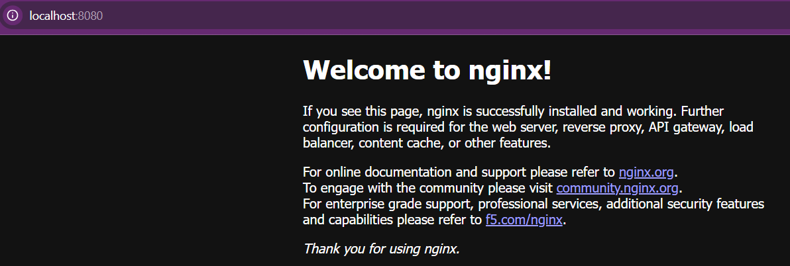

1 - Vérification de la version de Docker

C:\Users\rhmha>docker --version
Docker version 29.9.2, build a82e528

2 - Images stockées localement

C:\Users\rhmha>docker images

IMAGE ID DISK USAGE CONTENT SIZE EXTRA

3 - Pulling image hello-world

C:\Users\rhmha>docker pull hello-world
Using default tag: latest
latest: Pulling from library/hello-world
4f55086f7dd0: Pull complete
d5e71e642bf5: Download complete
Digest: sha256:c567b231f65614688711a75f31518a064258a51d442117a3e771a3a8fdba78ef
Status: Downloaded newer image for hello-world:latest
docker.io/library/hello-world:latest

4 - Running image

C:\Users\rhmha>docker run hello-world

Hello from Docker!
This message shows that your installation appears to be working correctly.

5 - Conteneurs actifs

C:\Users\rhmha>docker ps
CONTAINER ID IMAGE COMMAND CREATED STATUS PORTS NAMES

6 - Tous les conteneurs

C:\Users\rhmha>docker ps -a
CONTAINER ID IMAGE COMMAND CREATED STATUS PORTS NAMES
a0ca4c5672da hello-world "/hello" 2 minutes ago Exited (0) 2 minutes ago jolly_black

7 - Supprimer conteneur

C:\Users\rhmha>docker rm a0ca4c5672da
a0ca4c5672da

C:\Users\rhmha>docker ps -a
CONTAINER ID IMAGE COMMAND CREATED STATUS PORTS NAMES

8 - Supprimer une image

C:\Users\rhmha>docker images
IMAGE ID DISK USAGE CONTENT SIZE EXTRA
hello-world:latest c567b231f656 25.9kB 9.49kB

C:\Users\rhmha>docker rmi c567b231f656
Untagged: hello-world:latest
Deleted: sha256:c567b231f65614688711a75f31518a064258a51d442117a3e771a3a8fdba78ef

C:\Users\rhmha>docker images
IMAGE ID DISK USAGE CONTENT SIZE EXTRA

4. Exercice : Création d'un serveur web avec Docker

1 - Pulling NGINX

C:\Users\rhmha>docker pull nginx
Using default tag: latest
latest: Pulling from library/nginx
6d2e43921e9e: Pull complete
7cb4701ce7cd: Pull complete
1724c05f72c6: Pull complete
37fb86c2a767: Pull complete
512ac5e7ce8e: Pull complete
1962e1ff75b4: Pull complete
bbb080c71d50: Pull complete
d2c7e31f04a3: Download complete
4582dace95e2: Download complete
Digest: sha256:165ddde8751e75a1c907d24ef10d9f6deb08b57e0fe56caf67512486aff76d82
Status: Downloaded newer image for nginx:latest
docker.io/library/nginx:latest

2 - Running NGINX

C:\Users\rhmha>docker run -d -p 8080:80 --name mon_nginx nginx
977688ad8adfd6b37ab9cb52922a74049d3c0bcaa0b61c4534200403af962b89

3 - Verify active container

C:\Users\rhmha>docker ps
CONTAINER ID IMAGE COMMAND CREATED STATUS PORTS NAMES
977688ad8adf nginx "/docker-entrypoint.…" About a minute ago Up About a minute 0.0.0.0:8080->80/tcp, [::]:8080->80/tcp mon_nginx

4 - Default NGINX page

5 - Stopping image

C:\Users\rhmha>docker stop mon_nginx
mon_nginx

C:\Users\rhmha>docker ps
CONTAINER ID IMAGE COMMAND CREATED STATUS PORTS NAMES

C:\Users\rhmha>docker ps -a
CONTAINER ID IMAGE COMMAND CREATED STATUS PORTS NAMES
977688ad8adf nginx "/docker-entrypoint.…" 3 minutes ago Exited (0) 18 seconds ago mon_nginx

6 - Removing container

C:\Users\rhmha>docker rm mon_nginx
mon_nginx

C:\Users\rhmha>docker ps -a
CONTAINER ID IMAGE COMMAND CREATED STATUS PORTS NAMES
