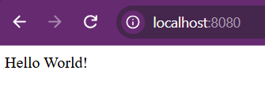
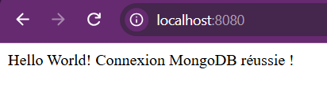

Exercice: Manipulation de base des conteneurs

1 - Vérification de la version de Docker

C:\Users\rhmha>docker --version
Docker version 29.9.2, build a82e528

2 - Images stockées localement

C:\Users\rhmha>docker images

IMAGE ID DISK USAGE CONTENT SIZE EXTRA

3 - Téléchargement de l'image hello-world

C:\Users\rhmha>docker pull hello-world
Using default tag: latest
latest: Pulling from library/hello-world
4f55086f7dd0: Pull complete
d5e71e642bf5: Download complete
Digest: sha256:c567b231f65614688711a75f31518a064258a51d442117a3e771a3a8fdba78ef
Status: Downloaded newer image for hello-world:latest
docker.io/library/hello-world:latest

4 - Exécution de l'image

C:\Users\rhmha>docker run hello-world

Hello from Docker!
This message shows that your installation appears to be working correctly.

5 - Liste des conteneurs actifs

C:\Users\rhmha>docker ps
CONTAINER ID IMAGE COMMAND CREATED STATUS PORTS NAMES

6 - Liste de tous les conteneurs

C:\Users\rhmha>docker ps -a
CONTAINER ID IMAGE COMMAND CREATED STATUS PORTS NAMES
a0ca4c5672da hello-world "/hello" 2 minutes ago Exited (0) 2 minutes ago jolly_black

7 - Supprimer un conteneur

C:\Users\rhmha>docker rm a0ca4c5672da
a0ca4c5672da

C:\Users\rhmha>docker ps -a
CONTAINER ID IMAGE COMMAND CREATED STATUS PORTS NAMES

8 - Supprimer une image

C:\Users\rhmha>docker images
IMAGE ID DISK USAGE CONTENT SIZE EXTRA
hello-world:latest c567b231f656 25.9kB 9.49kB

C:\Users\rhmha>docker rmi c567b231f656
Untagged: hello-world:latest
Deleted: sha256:c567b231f65614688711a75f31518a064258a51d442117a3e771a3a8fdba78ef

C:\Users\rhmha>docker images
IMAGE ID DISK USAGE CONTENT SIZE EXTRA

Exercice : Création d'un serveur web avec Docker

1 - Téléchargement de l'image officielle NGINX

C:\Users\rhmha>docker pull nginx
Using default tag: latest
latest: Pulling from library/nginx
6d2e43921e9e: Pull complete
7cb4701ce7cd: Pull complete
1724c05f72c6: Pull complete
37fb86c2a767: Pull complete
512ac5e7ce8e: Pull complete
1962e1ff75b4: Pull complete
bbb080c71d50: Pull complete
d2c7e31f04a3: Download complete
4582dace95e2: Download complete
Digest: sha256:165ddde8751e75a1c907d24ef10d9f6deb08b57e0fe56caf67512486aff76d82
Status: Downloaded newer image for nginx:latest
docker.io/library/nginx:latest

2 - Exécution de NGINX

C:\Users\rhmha>docker run -d -p 8080:80 --name mon_nginx nginx
977688ad8adfd6b37ab9cb52922a74049d3c0bcaa0b61c4534200403af962b89

3 - Liste des conteneurs actifs

C:\Users\rhmha>docker ps
CONTAINER ID IMAGE COMMAND CREATED STATUS PORTS NAMES
977688ad8adf nginx "/docker-entrypoint.…" About a minute ago Up About a minute 0.0.0.0:8080->80/tcp, [::]:8080->80/tcp mon_nginx

4 - Page NGINX par défaut

5 - Arrêt du conteneur

C:\Users\rhmha>docker stop mon_nginx
mon_nginx

C:\Users\rhmha>docker ps
CONTAINER ID IMAGE COMMAND CREATED STATUS PORTS NAMES

C:\Users\rhmha>docker ps -a
CONTAINER ID IMAGE COMMAND CREATED STATUS PORTS NAMES
977688ad8adf nginx "/docker-entrypoint.…" 3 minutes ago Exited (0) 18 seconds ago mon_nginx

6 - Suppresion du conteneur

C:\Users\rhmha>docker rm mon_nginx
mon_nginx

C:\Users\rhmha>docker ps -a
CONTAINER ID IMAGE COMMAND CREATED STATUS PORTS NAMES

Exercice : Déploiement d'une application Python Flask

Ajout d'un Dockerfile dans l'app
Construction de l'image de l'app 

C:\Users\rhmha\Documents\Master 2\CI-CD\tp_docker\tp_docker>docker build -t flask_app:1.0 .
[+] Building 6.9s (9/9) FINISHED              

C:\Users\rhmha\Documents\Master 2\CI-CD\tp_docker\tp_docker>docker images
IMAGE                                                    ID             DISK USAGE   CONTENT SIZE   EXTRA
flask_app:1.0                                            777d85292ecd       89.5MB         22.5MB
nginx:latest                                             165ddde8751e        243MB         66.8MB

Lancement du conteneur

C:\Users\rhmha\Documents\Master 2\CI-CD\tp_docker\tp_docker>docker run -d --name flask_app -p 8080:5000 flask_app:1.2
61246b60408cff31411c3ba5660ac5dabc1a77fa87b420f7da5b2fcd9c7151de

Test de l'app sur le navigateur

C:\Users\rhmha\Documents\Master 2\CI-CD\tp_docker\tp_docker>curl localhost:8080
Hello World!

Exercice : Utilisation de docker compose

Complétion du fichier app.py avec une connexion bdd mongoDB
Ajout fichier docker compose avec les deux conteneurs
Lancement du docker compose

